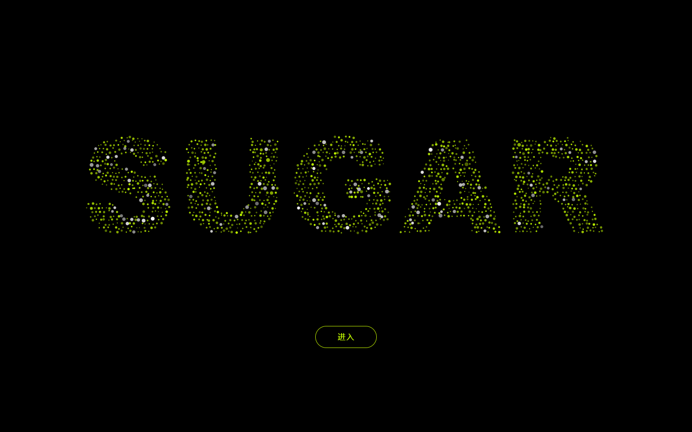

# SUGAR 粒子开场

原站视觉参考：https://cn.streamax.com/ 。品牌图形改为横排 SUGAR，并按确认后的新需求加入实时鼠标 / 触屏交互。

## 鼠标与手指交互

开场约 3.2 秒聚合后，将鼠标移到字母附近：局部粒子会被推开，并随移动方向产生轻微拖曳与惯性。移开鼠标后，粒子通过阻尼弹簧回到各自的归位点，恢复完整 SUGAR。快速扫过五个字母可以连续拨动粒子。

手机端用手指在字母区域按住并滑动；松手即恢复。点击“进入”仍是唯一退出方式。

## 直接打开

双击 `dist/index.html` 即可离线运行，不需要安装依赖。也可以从本目录运行：

```powershell
python -m http.server 8741 --bind 127.0.0.1 --directory dist
```

打开 http://127.0.0.1:8741/ 。每次刷新完整重播，没有 localStorage、Cookie 或会话跳过逻辑。

## 接入现有首页

把 `dist/sugar-intro.js` 复制到网站静态资源目录，在首页加载脚本，并将元素放在 body 最后一层：

```html
<script src="/sugar-intro.js" defer></script>
<!-- 现有首页的全部内容继续保留 -->
<sugar-intro></sugar-intro>
```

开场只保留 SUGAR 粒子字形与“进入”按钮。`dist/index.html` 中的 `<main>` 是进入后的演示 Hero，可直接替换为真实首页。没有改动任何现有网站。

组件使用 Shadow DOM 隔离样式。进入时清除全部动画、监听器与遮罩，恢复背景滚动及原有 inert 状态，不改变 URL。需要指定退出后的键盘焦点，可在首页标题添加 `tabindex="-1" data-intro-focus`。

```js
document.addEventListener('sugar:intro-complete', () => {
  // 可选：在这里启动首页本身的内容。
});
```

## 行为与参数

- 纯黑全屏遮罩；圆点以 #C6FF00 / #B8E600 为主，约 6% 白色。
- 开场散布约 0.36 秒，随后以 2.46–2.64 秒缓动和 0–0.18 秒错峰延迟汇聚；约 3.2 秒定型。
- 桌面 1000–1800 粒子，移动端 480–850 粒子；字形宽约视口 76%。
- 离屏 Canvas 用 900 字重无衬线绘字、按透明度采样，保留五个字母的全部笔画。
- 无输入时不改目标点，不旋转、不呼吸；单轴漂移上限 1.55px，仅亮度闪烁。
- 鼠标影响半径随屏幕缩放：桌面约 100–156px，手机约 46–74px；局部排斥叠加鼠标速度拖曳，不同粒子有轻微响应差异，移开后以阻尼弹簧平滑归位。
- 静止时约 30fps；鼠标 / 手指扰动、弹性归位、汇聚和退出约 60fps；DPR 最高为 2。
- 窗口变化后重新采样，约 0.65 秒过渡；页面隐藏时停止 requestAnimationFrame，返回时续播。
- 粒子响应鼠标移动与手指滑动，仅“进入”按钮触发退出。
- 触摸取消、鼠标离开页面、窗口失焦、切后台及窗口缩放时清除输入，避免粒子停留在扰动状态。
- 点击后约 0.9 秒径向散开并移除遮罩，文字和按钮同步淡出；重复点击被忽略。
- 支持键盘 Tab → Enter；背景在遮罩显示期间 inert。

## 文件

- `dist/index.html`：可离线运行的演示首页。
- `dist/sugar-intro.js`：可复用的完整开场组件，无第三方依赖。
- `dist/favicon.svg`：演示图标。

低端真机流畅度和不同系统的字体栅格表现仍需在目标设备确认；模拟视口和 CPU 降速不能替代真机测试。


## 在线体验与源码

- [GitHub Pages 在线体验](https://sugarvei.github.io/sugar-particle-intro/)
- [GitHub 源码](https://github.com/SugarVei/sugar-particle-intro)
- `SUGAR.html` 是可双击离线打开的单文件版本。
- 每次推送 main，GitHub Actions 自动把 `dist/` 发布到 GitHub Pages。


